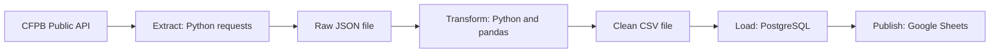

# CFPB Consumer Complaints ETL Pipeline

An end-to-end data pipeline that extracts consumer complaint records from the Consumer Financial Protection Bureau (CFPB) public API, transforms the response into a clean dataset, loads it into PostgreSQL, and publishes the table to Google Sheets. Apache Airflow orchestrates the workflow, and Docker Compose runs the Airflow services.

## Pipeline overview



The Airflow DAG runs these tasks in sequence:

1. `extract_data` requests complaint records from the CFPB API and saves the raw response under `data/raw/`.
2. `transform_data` cleans and prepares the records, writing the result under `data/processed/`.
3. `load_data` loads the processed records into the PostgreSQL table `consumer_complaints`.
4. `upload_to_google_sheets` reads the PostgreSQL table and refreshes the `CFPB_Data` worksheet.

The DAG ID is `cfpb_etl_pipeline`. Its schedule is `@daily`; the DAG is configured with `catchup=False`.

## Technology stack

- Python, `requests`, and `pandas`
- Apache Airflow 3.3.1
- Docker Compose and CeleryExecutor
- Redis for the Airflow task queue
- PostgreSQL for Airflow metadata and the ETL destination data
- SQLAlchemy and `psycopg2` for database access
- `gspread` and Google service-account authentication for Google Sheets

> Airflow's Compose PostgreSQL service stores Airflow metadata. The ETL destination database is configured separately through `DB_*` environment variables.

## Repository structure

```text
CFPB_ETL_Project/
├── airflow/
│   ├── dags/
│   │   └── cfpb_etl_dag.py
│   ├── docker-compose.yaml
│   ├── Dockerfile
│   └── requirements-airflow.txt
├── credentials/                 # Local only; do not commit
│   └── google_credentials.json  # Local only; do not commit
├── data/
│   ├── raw/
│   └── processed/
├── scripts/
│   ├── extract.py
│   ├── transform.py
│   ├── load.py
│   └── google_sheet.py
├── config.py
├── requirements.txt
├── .env                         # Local only; do not commit
└── README.md
```

If your local filenames differ, update the tree to match the repository before publishing.

## Prerequisites

- Docker Desktop with Docker Compose
- Python 3.13 for running the scripts locally (the supplied Airflow image uses Python 3.13)
- A PostgreSQL server and a database for the complaint data
- A Google Cloud service account with Google Sheets API access
- A Google spreadsheet shared with the service-account email address

## Configuration

Create the environment files locally; never commit them:

- Project-root `.env`: `DB_HOST`, `DB_PORT`, `DB_NAME`, `DB_USER`, and `DB_PASSWORD` for the ETL destination database.
- `airflow/.env`: Airflow-specific settings such as `AIRFLOW_UID` and `FERNET_KEY`.
- `credentials/google_credentials.json`: the Google service-account key file.

The Compose configuration should load both environment files and mount the credentials directory read-only at `/opt/airflow/credentials`. The Google Sheets script expects the key at `/opt/airflow/credentials/google_credentials.json`.

When PostgreSQL runs directly on the Windows host, set `DB_HOST=host.docker.internal`. When it runs in Docker Compose, use the PostgreSQL service name as the host. `localhost` inside an Airflow container refers to that container, not the Windows host.

In `scripts/google_sheet.py`, configure the spreadsheet ID and worksheet name for your own Google Sheet. Share the spreadsheet with the service-account email address, with permission to edit it.

## Run with Docker Compose

From the repository's `airflow/` directory:

```bash
docker compose up -d --build
```

Check that services are running:

```bash
docker compose ps
```

Open the Airflow UI at [http://localhost:8080](http://localhost:8080). Unpause `cfpb_etl_pipeline` to allow its schedule to run. To run it immediately, use the DAG's **Trigger** action in the UI.

To view Airflow service logs:

```bash
docker compose logs -f airflow-scheduler airflow-dag-processor airflow-worker
```

To stop the services without deleting the persisted database volumes:

```bash
docker compose down
```

Do not use `docker compose down -v` unless you intentionally want to delete the Docker volumes and their stored data.

## Run scripts locally

Install the project dependencies in a Python virtual environment, configure the root `.env`, and make sure PostgreSQL is reachable. Then run the stages in order from the repository root:

```bash
python scripts/extract.py
python scripts/transform.py
python scripts/load.py
python scripts/google_sheet.py
```

Airflow is the recommended way to run the scheduled pipeline; the commands above are useful for local debugging.

## Data and refresh behavior

- Raw API output is stored in `data/raw/complaints.json`.
- Transformed output is stored in `data/processed/complaints_clean.csv`.
- PostgreSQL is the pipeline's destination database.
- The Google Sheets task clears and refreshes the `CFPB_Data` worksheet from the database table. It publishes a current snapshot; it does not preserve a separate daily history in the sheet.
- Airflow schedules the DAG once daily when it is unpaused and the Docker services are running. It does not run instantly after every API change.

## Current limitation

The extraction request currently asks the CFPB API for `size=200`, and the script does not include a pagination loop. Therefore, one run requests at most 200 records. Add pagination or an incremental date-based extraction strategy before describing this as a complete historical backfill.

## Security before publishing to GitHub

- Never commit `.env`, `airflow/.env`, service-account JSON keys, database passwords, or other credentials.
- Add those paths to `.gitignore` and commit safe `.env.example` files with placeholder values only.
- If a real service-account key has already been shared or committed, revoke it in Google Cloud and create a replacement.
- Consider moving the spreadsheet ID from `scripts/google_sheet.py` into an environment variable or Airflow Connection before publishing the repository.

## Future improvements

- Add pagination or a date cursor to extract more than 200 records safely.
- Add validation for required fields, duplicate complaint IDs, and empty API responses.
- Configure task retries and failure notifications in Airflow.
- Add a data-quality or row-count check before refreshing Google Sheets.
- Add automated tests for extraction, transformation, and database loading.
